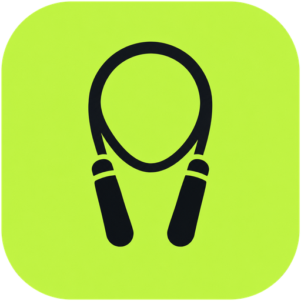

<div align="center">



# JumpTrack

**Cuenta tus saltos de cuerda con la cámara del celular.**
Sin tocar la pantalla, sin internet, sin cuentas.


</div>

---

## ✨ Qué hace

| | |
|---|---|
| 📷 **Conteo automático** | La cámara sigue tus tobillos y caderas con MediaPipe Pose y cuenta cada salto al aterrizar. |
| 🔊 **Avisos por voz** | "50 saltos", "Serie 2 completada. Descanso", cuenta regresiva "3, 2, 1, ¡Ya!". |
| 🔁 **Modo series** | Elige series, meta por saltos o por tiempo y descanso con cuenta regresiva. |
| ⏱️ **Modo libre** | Un toque en **Libre** y a saltar, sin metas. |
| 🔥 **Rachas** | Racha actual, mejor racha y calendario con los días entrenados. |
| 📊 **Resumen** | Total, tiempo, saltos por minuto, récord en 1 minuto y velocidad de cada serie. |
| 🌙 **Hecha para entrenar** | Modo oscuro, botones grandes y pantalla siempre encendida. |
| 🔒 **Privada** | Las imágenes se procesan en el teléfono y nunca se guardan. Los datos viven solo en tu dispositivo. |

## 📱 Pantallas

- **Inicio**: saltos de hoy frente a tu meta diaria, racha de la semana, récord en 1 minuto y accesos a *Libre* y *Series*.
- **Entrenar por series**: configura el plan y ve una estimación del total ("1.000 saltos · ~12 min").
- **Entrenamiento**: vista de cámara, contador gigante, progreso de la serie, cronómetro, saltos/min y total del día.
- **Resumen**: resultados del entrenamiento con la velocidad de cada serie.
- **Calendario**: días de la racha, días entrenados y el detalle de cada día.
- **Ajustes**: meta diaria de saltos.

## 🚀 Empezar

Necesitas **Node 22+**.

```sh
npm install
npm run dev
```

Abre <http://localhost:5173> y permite el acceso a la cámara. Así puedes desarrollar en el navegador con la webcam del computador.

> [!NOTE]
> El navegador solo permite la cámara en `localhost` o con HTTPS. Para probar desde el celular por la red local hace falta servir con HTTPS; con el APK no hay ese problema.

## 🤖 APK de Android

Requisitos: **Android SDK** y **JDK 21**. El script usa por defecto el JDK que trae Android Studio; si tienes otro, indícalo con `JAVA_HOME_21`.

```sh
npm run android:apk
```

El APK queda en `android/app/build/outputs/apk/debug/app-debug.apk`. Para abrir el proyecto nativo en Android Studio:

```sh
npm run android:open
```

## 🧰 Scripts

| Comando | Para qué |
|---|---|
| `npm run dev` | Servidor de desarrollo (también accesible desde la red local) |
| `npm run build` | Compila TypeScript y genera `dist/` |
| `npm run preview` | Sirve la versión compilada |
| `npm run lint` | Revisa el código con oxlint |
| `npm test` | Tests del detector de saltos, rachas y récord por minuto |
| `npm run android:sync` | Compila y copia la web al proyecto Android |
| `npm run android:apk` | Genera el APK de depuración |
| `npm run android:open` | Abre el proyecto en Android Studio |

## 🧠 Cómo cuenta los saltos

1. **MediaPipe Pose Landmarker** detecta 33 puntos del cuerpo en cada frame de la cámara.
2. `JumpDetector` toma la altura de **tobillos y caderas** y la divide por la altura del cuerpo (hombros a tobillos), así no importa qué tan lejos esté el teléfono.
3. Compara esa señal con su **media móvil**: cuando sube claramente por encima, estás en el aire; cuando vuelve a bajar, **cuenta un salto**.
4. Un umbral adaptativo y un mínimo de 180 ms entre saltos evitan contar el temblor de los puntos detectados.

¿Cuenta de más o de menos? Ajusta `MIN_THRESHOLD` y `AMPLITUDE_FACTOR` en [`src/pose/jumpDetector.ts`](src/pose/jumpDetector.ts).

> [!TIP]
> Para mejores resultados apoya el teléfono a 2–3 m, en vertical, y que se vea tu cuerpo entero de pies a cabeza.

## 🗂️ Estructura

```text
src/
├── screens/        Inicio, Series, Entrenamiento, Resumen, Calendario, Ajustes
├── components/     Cámara con detección, stepper, selector, diálogo…
├── training/       Máquina de estados del entrenamiento y configuración
├── pose/           Carga de MediaPipe y detector de saltos
├── lib/            Fechas, formato, rachas, voz, estadísticas, ajustes
├── db.ts           Base de datos local (IndexedDB con Dexie)
└── index.css       Tema oscuro y estilos
public/models/      Modelo de pose empaquetado (funciona sin internet)
android/            Proyecto nativo de Capacitor
```

## 🛠️ Stack

- **UI:** React 19 + TypeScript, Vite, React Router, Lucide icons
- **Visión:** MediaPipe Tasks Vision (Pose Landmarker lite, GPU con respaldo en CPU)
- **Datos:** IndexedDB con Dexie y consultas en vivo
- **Nativo:** Capacitor 8 (texto a voz, pantalla encendida y botón atrás de Android)
- **Tipografías:** Manrope y Space Grotesk, incluidas en la app

---

<div align="center">

Hecho por Sebastian Londoño

[](https://www.instagram.com/sebax_lond/)

</div>
